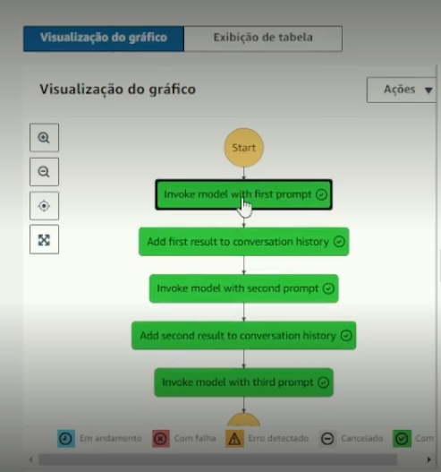

#  Assistente de Delivery Inteligente com AWS Step Functions e Amazon Bedrock

Um assistente virtual de delivery automatizado construído na AWS. O projeto utiliza o *AWS Step Functions* para orquestrar o fluxo de trabalho e o *Amazon Bedrock* (com o modelo Claude 3 Haiku) como a inteligência artificial responsável por interpretar os pedidos dos clientes.

Projeto prático desenvolvido para o Bootcamp da [Digital Innovation One (DIO)](https://dio.me).

---

## 🛠️ Arquitetura do Projeto

O fluxo de trabalho foi desenhado utilizando a linguagem *ASL (Amazon States Language)* e segue a seguinte lógica visual:

mermaid
graph TD
    A[Início do Pedido] --> B(Entender o Pedido com Bedrock)
    B --> C{Aguardar Preparo/Envio}
    C --> D[Finalizar Pedido com Sucesso]

> 💡 *Dica de Visualização:* 

---

## 💻 Código do Workflow (JSON/ASL)

Este é o código utilizado para criar a máquina de estados no AWS Step Functions:

json
{
  "Comment": "An example of using Bedrock to chain prompts and their responses together.",
  "StartAt": "pergunta idéias de combinação",
  "QueryLanguage": "JSONata",
  "States": {
    "Add first result to conversation history": {
      "Type": "Pass",
      "Assign": {
        "counter": "",
        "conversation_history": [
          ""
        ],
        "input_prompts": ""
      },
      "Next": "pergunta idéias de bebida"
    },
    "Add second result to conversation history": {
      "Type": "Pass",
      "Assign": {
        "counter": "",
        "conversation_history": [
          ""
        ],
        "input_prompts": ""
      },
      "Next": "pergunta lugar ideal"
    },
    "pergunta idéias de combinação": {
      "Type": "Task",
      "Resource": "arn:aws:states:::bedrock:invokeModel",
      "Arguments": {
        "ModelId": "arn:aws:bedrock:us-east-1::foundation-model/moonshotai.kimi-k2.5",
        "Body": {
          "anthropic_version": "bedrock-2023-05-31",
          "max_tokens": 2000,
          "messages": [
            {
              "role": "user",
              "content": [
                {
                  "type": "text",
                  "text": "Estou programando um jantar romantico, nesse jantar irei pedir um macarrão, me de uma lista de 3 itens que combinam em uma experiencia gastronomico "
                }
              ]
            }
          ]
        },
        "ContentType": "application/json",
        "Accept": "application/json"
      },
      "Assign": {
        "conversation_history": "",
        "counter": ""
      },
      "Next": "Add first result to conversation history",
      "Output": {
        "result_one . $": "$.Body.content[0].text"
      }
    },
    "pergunta idéias de bebida": {
      "Type": "Task",
      "Resource": "arn:aws:states:::bedrock:invokeModel",
      "Arguments": {
        "ModelId": "arn:aws:bedrock:us-east-1::foundation-model/moonshotai.kimi-k2.5",
        "Body": {
          "anthropic_version": "bedrock-2023-05-31",
          "max_tokens": 2000,
          "messages": [
            {
              "role": "user",
              "content": [
                {
                  "type": "text",
                  "text": "Liste duas bebibas que acompanhe um jantar romantico"
                }
              ]
            }
          ]
        },
        "ContentType": "application/json",
        "Accept": "application/json"
      },
      "Assign": {
        "conversation_history": "",
        "counter": ""
      },
      "Next": "Add second result to conversation history",
      "Output": {
        "result_two.$": "$.Body.content[0].text"
      }
    },
    "pergunta lugar ideal": {
      "Type": "Task",
      "Resource": "arn:aws:states:::bedrock:invokeModel",
      "Arguments": {
        "ModelId": "arn:aws:bedrock:us-east-1::foundation-model/moonshotai.kimi-k2.5",
        "Body": {
          "anthropic_version": "bedrock-2023-05-31",
          "max_tokens": 2000,
          "messages": [
            {
              "role": "user",
              "content": [
                {
                  "type": "text",
                  "text": "Liste um lugar perfeito para jantar romantico em Paris "
                }
              ]
            }
          ]
        },
        "ContentType": "application/json",
        "Accept": "application/json"
      },
      "Assign": {
        "conversation_history": "",
        "counter": ""
      },
      "End": true,
      "Output": {
        "result_two.$": "$.Body.content[0].text"
      }
    }
  }
}

---

## 🚀 Como Replicar este Projeto

### 1. Configurar o Modelo no Amazon Bedrock
* Acesse o console da *AWS* e mude para a região *us-east-1 (N. Virginia)* ou outra região com Bedrock disponível.
* Pesquise por *Amazon Bedrock*.
* No menu esquerdo, clique em *Model access*.
* Clique em *Manage model access, marque o modelo **Anthropic (Claude)* ou *Claude 3 Haiku* e salve as alterações.

### 2. Criar a Máquina de Estados no AWS Step Functions
* Pesquise por *Step Functions* no console AWS.
* Clique em *Create state machine* -> Escolha *Blank* (Em branco).
* Mude o editor do modo visual para o modo *Code* (Código).
* Cole o código JSON fornecido acima.
* Clique em *Create* (A AWS criará automaticamente as permissões de IAM necessárias).

### 3. Executar e Testar
* Clique em *Start execution*.
* Acompanhe os blocos mudando de cor até todos ficarem verdes.
* Verifique o resultado final na aba *Output* do último bloco!

---

## 📈 Próximos Passos (Melhorias Futuras)

Para evoluir este projeto, pretendo implementar as seguintes melhorias:
* *Banco de Dados (AWS DynamoDB):* Salvar o histórico de pedidos e o status de cada cliente.
* *Notificações em Tempo Real (AWS SNS):* Enviar um SMS ou e-mail de verdade para o cliente quando o pedido sair para a entrega.
* *Validação de Cupons:* Criar um passo intermediário para verificar se o cliente tem direito a desconto usando funções AWS Lambda.

---

## 👤 Autor

Desenvolvido por *[Elias Santos]*  
👋 Entre em contato:
* *LinkedIn:* [https://www.linkedin.com/in/elias-santos-/]
* *GitHub:* [https://github.com/elias-santos87/]